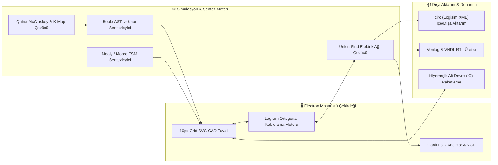

<div align="center">

# 🖥️ LogicDesign Studio — Desktop Edition
### **Dijital Mantık Devre Tasarımı, EDA Şematik Çizim & Gerçek Zamanlı Donanım Simülasyon Masaüstü Uygulaması**

[](https://www.electronjs.org/)
[](https://react.dev/)
[](https://www.typescriptlang.org/)
[](#)
[](#)

<p align="center">
  <b>Kurulum gerektirmeyen taşınabilir (Portable `.exe`) masaüstü CAD ortamında temel mantık kapılarından 4-Bit SAP-1 mikroişlemci mimarilerine, 8-Bit Chiptune ses synthesizer'larından 16x16 RGB VRAM GPU ekranlarına kadar her seviyedeki sayısal sistemi tasarlayın ve simüle edin.</b>
</p>

---

[🖥️ **Masaüstü Uygulaması (logic-design-studio)**](https://github.com/SafakSahinn/logic-design-studio) • [🌐 **Web Platformu (logic-design-web)**](https://github.com/SafakSahinn/logic-design-web) • [🚀 **Canlı Web Sürümü (Live App)**](https://safaksahinn.github.io/logic-design-web/)

</div>

---

## ✨ Masaüstü Sürümü Öne Çıkan Özellikler

- **🚀 Kurulumsuz Taşınabilir (`Portable .exe`) Çalışma:** Tek tıkla doğrudan çalışan `LogicDesign Studio-Portable.exe` paketi ile çevrimdışı (offline) yüksek performanslı CAD deneyimi.
- **📐 Logisim Standardında 10px Ortogonal Kablolama Motoru (`WireRepair`):**
  - İlk hareket yönüne duyarlı (`Yatay-İlk` / `Dikey-İlk`) 90° dik açılı L-büküm kablo çizimi.
  - Mevcut bir kablonun herhangi bir noktasından doğrudan dal (branch) çekme, kablo uçlarını sürükleyerek uzatma/kısaltma.
  - Kapıların ikinci girişine (`B`) kablo çekerken komşu giriş pini (`A`) üzerinden geçip kısa devre oluşturmayı önleyen akıllı pin çevresi dolanımı.
  - Yalnızca $\ge 3$ kablo segmentinin birleştiği gerçek kavşaklarda lehim noktası (solder dot) oluşturan Logisim `CircuitWires` mimarisi.
- **🔌 36+ Donanım Bileşeni & 74HC/74LS Entegre Kütüphanesi:** Mantık kapıları, Flip-Flop'lar, 74HC181 4-Bit ALU, 74HC85 Karşılaştırıcı, 74HC194 Shift Register, 74HC189 16x4 RAM, 16x4 ROM, 8-Bit Chiptune Buzzer, 8x8 LED Matris ve 16x16 RGB VRAM Ekran.
- **🧠 Otomatik Sentez & Analiz Araçları:** Doğruluk Tablosu, Quine-McCluskey & Karnaugh Haritası (K-Map) çözücü, Boole cebri ifadesinden otomatik devre çizimi, FSM sentezleyici, çok kanallı lojik osiloskop (`.vcd` çıktılı), `.circ` Logisim XML içe/dışa aktarımı ve FPGA Verilog/VHDL üreticisi.

---

## 🧩 Sistem Mimarisi



---

## 🔌 Donanım Bileşen Katalogu

| Kategori | Bileşenler |
| :--- | :--- |
| **🟢 Giriş Birimleri** | Anahtar (`Switch`), Anlık Buton (`Pushbutton`), 4-Bit DIP Anahtar (`DIP Switch`), Saat Üreteci (`Clock 0.5Hz–8Hz`), `VCC (1)`, `GND (0)`, 7-Bit `ASCII Klavye Terminali` |
| **🔵 Mantık Kapıları** | `AND`, `OR`, `NOT`, `NAND`, `NOR`, `XOR`, `XNOR` (2–5 girişli yapılandırılabilir), 3 Durumlu Tampon (`Tri-State Buffer`), Kablosuz `Tünel (Tunnel)` |
| **🟣 Kombinasyonel Entegreler** | Yarım/Tam Toplayıcı (`Half/Full Adder`), Yarım/Tam Çıkarıcı (`Half/Full Subtractor`), `2:1 / 4:1 / 8:1 MUX (74HC151)`, `1:2 / 1:4 DEMUX`, `2:4 / 3:8 Decoder (74HC138)`, `BCD to 7-Seg (74LS47)`, `4:2 Priority Encoder (74HC148)`, `4-Bit Karşılaştırıcı (74HC85)`, `4-Bit ALU (74HC181)`, `4-Bit Veri Yolu Ayırıcı (Splitter)` |
| **🟠 Ardışıl Devre & Bellekler** | `D Flip-Flop`, `JK Flip-Flop`, `T Flip-Flop`, `SR Latch`, `4-Bit Senkron Sayaç (74HC161)`, `4-Bit Paralel Yazmaç (Register)`, `4-Bit Evrensel Kaydırmalı Yazmaç (74HC194)`, `16x4 RAM (74HC189)`, `16x4 ROM` |
| **🔴 Çıkış & Multimedya** | `5mm LED`, `Mantık Probu`, `4-Bit LED Bar`, `7-Segment Ekran`, `4-Bit Hex Gösterge (0-F)`, `8-Bit Chiptune Piezo Buzzer`, `8x8 LED Nokta Matris (GPU)`, `16x16 RGB VRAM Video Ekranı` |

---

## 💻 Kurulum, Geliştirme ve Derleme

### Doğrudan Çalıştırma (Windows)
Depo kök dizinindeki **`LogicDesign Studio-Portable.exe`** dosyasını çift tıklayarak kurulum yapmadan doğrudan çalıştırabilirsiniz.

### Kaynak Koddan Derleme
```bash
# 1. Bağımlılıkları yükleyin
npm install

# 2. Geliştirme modunda başlatın (Vite + Electron)
npm run dev
npm run electron:dev

# 3. Taşınabilir Windows .exe (Portable) paketi oluşturun
npm run build
npx electron-builder --win portable
```

---

## ⌨️ Klavye ve Fare Kısayolları

| Kısayol | İşlev |
| :--- | :--- |
| **Sol Tık (Pin / Kablo Üzeri) + Sürükle** | Pin'den veya mevcut bir kablonun herhangi bir noktasından 90° ortogonal kablo çekme |
| **Kablo Ucu Sürükle** | Mevcut kablo segmentini uzatma, kısaltma veya yeni köşe ekleme |
| **Sağ Tık Sürükle** / **Space + Sol Tık** | Tuvali serbest kaydırma (`Canvas Pan`) |
| **Fare Tekerleği (Scroll)** | Yakınlaştırma / Uzaklaştırma (`Zoom %40 – %250`) |
| **`Ctrl + Z` / `Ctrl + Y`** | Geri Al (`Undo`) / İleri Al (`Redo`) |
| **`Ctrl + C` / `Ctrl + V` / `Ctrl + D`** | Seçili bileşenleri Kopyala / Yapıştır / Çoğalt |
| **`R`** | Seçili bileşenleri 90° döndür |
| **`Delete` / `Backspace`** | Seçili bileşen veya kabloları sil (otomatik `WireRepair` onarımı ile) |
| **`Ctrl + K` veya `/`** | Hızlı Bileşen Arama & Ekleme Komut Paleti (`Spotlight`) |

---

## 📄 Lisans

Bu proje eğitim, akademik araştırma ve açık kaynaklı sayısal sistem mühendisliği çalışmaları için geliştirilmiştir.
